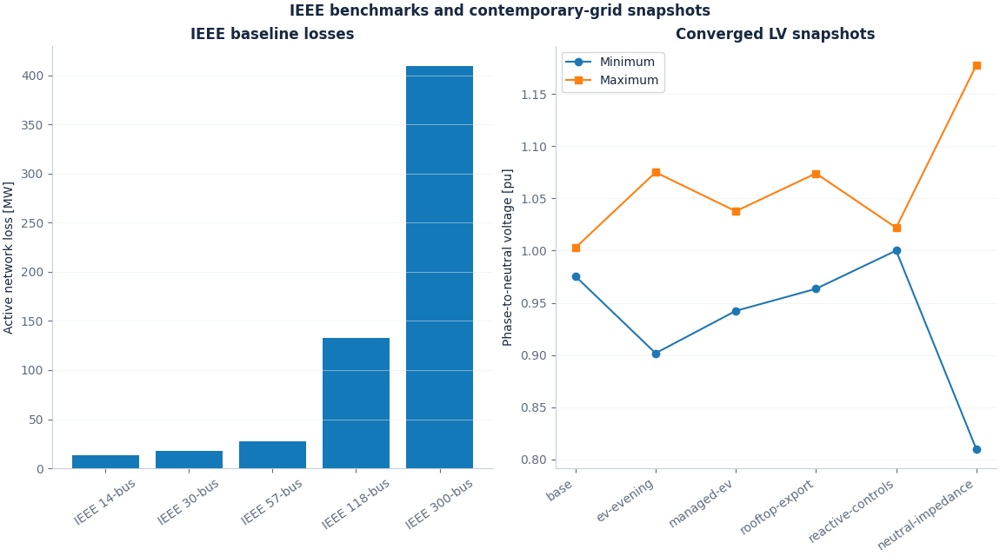

# IEEE benchmarks and contemporary-grid examples

[Open the complete results gallery](results/README.md)



The collection runs IEEE 14-, 30-, 57-, 118- and 300-bus cases from pinned
MATPOWER data, followed by demand-stress, line-outage and four-wire LV scenarios.
Every study includes reloadable input data, CSV/JSON results, full ASCII
connectivity and five SVG/PNG figure pairs. The results gallery links each
individual case, reference-voltage comparison and equipment check.

## Studies

| Group | Cases |
| --- | --- |
| IEEE baselines | 14, 30, 57, 118 and 300 buses |
| Transmission snapshots | IEEE 14 demand +50%; IEEE 118 non-islanding single-line outage |
| Four-wire LV snapshots | Base ZIP/delta demand; phase-A EV loading; managed EV loading; rooftop phase-to-neutral generation/export; ideal grounded-source reactive limits; elevated neutral impedance; extreme-neutral solver failure |

The IEEE cases use a separate balanced polar Newton implementation for numerical
comparison. NRlarge expands each balanced bus into three independent phase
conductors, preserving shunts, line charging, transformer taps, phase shifts,
online status and generator controls. Both formulations enable aggregate PV Q
limits and leave SLACK Q free. Test tolerances and actual errors are recorded in
the case receipts.

The LV scenarios use the repository's coupled four-wire feeder at a 0.1 MVA
three-phase base. EV/rooftop settings and all changes are explicit in `study.json`
and input CSVs. The rooftop devices connect phase to service neutral. The separate
reactive-control example uses the engine's ideal phase-to-ground PV controls.
One deliberately severe neutral case records nonconvergence and exports its
labelled final iterate. The collection command checks every expected outcome.

## Reproduce

Use the dependencies listed in [requirements-benchmarks.txt](../requirements-benchmarks.txt)
and an existing suitable environment. The GPU comparison also uses the optional
OpenGL/OpenCL runtimes described in the [NRlarge guide](../docs/NRlarge.md).

```sh
python -m benchmarks.run --check-only
python -m benchmarks.run --out my-benchmark-results
python -m benchmarks.verify --out my-benchmark-results
```

The output directory must be new or empty. The collection is bounded to 16 MiB.
This task used existing packages and small in-memory cases; no installation or
large grid export is needed to inspect the committed results.

An IEEE 14 demand sweep covers 0.8–1.8 times source demand. Each point is an
independent steady-state solve. A compute-path table records CPU sparse LU,
one/four-thread GMRES, OpenCL and OpenGL results on the same IEEE 14 case.
Timings include setup and describe one measured run on the recorded hardware.

`manifest.json` records package versions, source provenance and LF-normalized
producer-code hashes. `artifacts.json` records exact output-byte hashes. Scoped
Git attributes preserve the source and result bytes across Windows/Linux
checkouts. The verifier checks these hashes, all CSV status flags, reference
tolerances, image payloads and local gallery links.

## Sources and usage notes

- [Pinned MATPOWER source provenance](sources/matpower/provenance.json) and
  [source usage notes](sources/matpower/README.md).
- [UW Power Systems Test Case Archive](https://labs.ece.uw.edu/pstca/), the
  upstream archive identified in the converted case headers.
- [NIST TN 2289](https://www.nist.gov/publications/impact-price-responsive-load-and-volt-var-power-quality-losses-and-customer-economics)
  and [PNNL-22064](https://www.pnnl.gov/main/publications/external/technical_reports/PNNL-22064.pdf)
  provide context for flexible-demand, rooftop-generation and distribution-voltage studies.

[Acknowledgements, disclaimer and waiver](../ACKNOWLEDGEMENTS.md)
