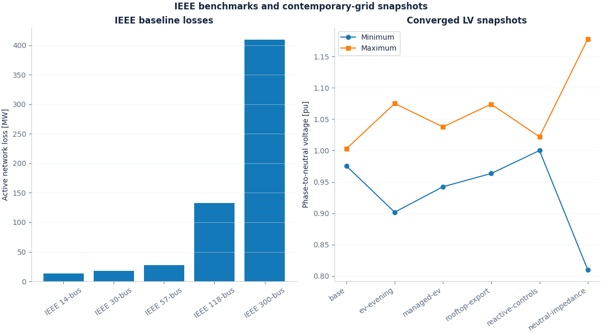
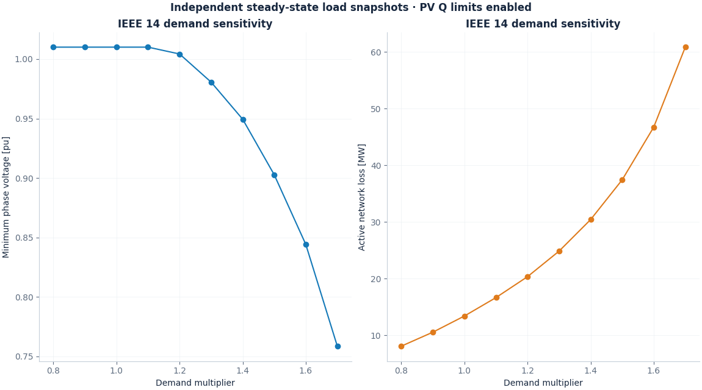
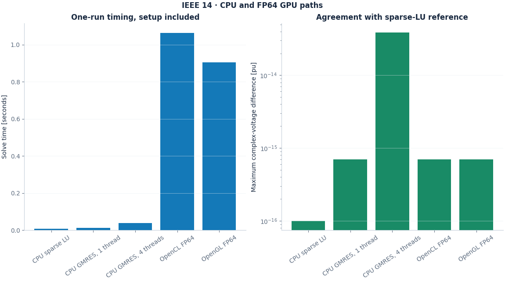

# IEEE and contemporary-grid results

Generated by `python -m benchmarks.run` on 2026-11-10 UTC. Each case includes reloadable inputs, numerical outputs, ASCII connectivity and SVG/PNG figures.

## Results

| Case | Status | Min phase V [pu] | Max phase V [pu] | Loss [MW] | Reference error [pu] |
| --- | --- | ---: | ---: | ---: | ---: |
| [IEEE 14-bus](ieee14/README.md) | Converged | 1.010000 | 1.090000 | 13.3933 | 1.81e-14 |
| [IEEE 30-bus](ieee30/README.md) | Converged | 0.991936 | 1.082000 | 17.5519 | 3.3e-13 |
| [IEEE 57-bus](ieee57/README.md) | Converged | 0.935932 | 1.059797 | 27.8638 | 2.35e-13 |
| [IEEE 118-bus](ieee118/README.md) | Converged | 0.943000 | 1.050000 | 132.481 | 6.05e-15 |
| [IEEE 300-bus](ieee300/README.md) | Converged | 0.928795 | 1.073500 | 409.537 | 6e-14 |
| [IEEE 14: demand +50%](ieee14-load-stress/README.md) | Converged | 0.902776 | 1.060000 | 37.4369 | 1.16e-13 |
| [IEEE 118: single-line outage](ieee118-line-outage/README.md) | Converged | 0.943000 | 1.050000 | 132.398 | 7.75e-15 |
| [Four-wire LV: base demand](lv-base/README.md) | Converged | 0.975455 | 1.002746 | 0.000276839 | — |
| [Four-wire LV: EV phase imbalance](lv-ev-evening/README.md) | Converged | 0.901689 | 1.075018 | 0.00172567 | — |
| [Four-wire LV: managed EV charging](lv-managed-ev/README.md) | Converged | 0.942228 | 1.037751 | 0.000757932 | — |
| [Four-wire LV: midday rooftop export](lv-rooftop-export/README.md) | Converged | 0.963389 | 1.073982 | 0.0023777 | — |
| [LV: ideal grounded-source Q limits](lv-reactive-controls/README.md) | Converged | 1.000000 | 1.021944 | 0.00199324 | — |
| [Four-wire LV: neutral impedance x2](lv-neutral-impedance/README.md) | Converged | 0.809774 | 1.177741 | 0.00299412 | — |
| [Four-wire LV: neutral impedance x4](lv-neutral-extreme/README.md) | Last iterate · line_search_failed | 0.665555 | 1.417439 | 0.00621282 | — |

[Zoomable comparison](comparison.svg)

## Demand sensitivity and compute paths

[Load-sweep CSV](load-sweep.csv) · [All sweep conductor voltages](load-sweep-voltages.csv) · [SVG](load-sensitivity.svg)

[Backend comparison CSV](backend-comparison.csv) · [Hardware receipt](hardware.json) · [SVG](backends.svg)

## Data and numerical conventions

MATPOWER provides the pinned case data. The separate balanced polar implementation in `benchmarks/cases.py` supplies the comparison values. The phase engine uses a per-conductor power base equal to the three-phase case MVA base divided by three. PV source Q bounds are enabled; SLACK Q remains unconstrained.

Voltage, generator and branch check files report source-data limits. Power-flow controls enforce PV Q bounds; generator P bounds, SLACK Q and branch thermal ratings are recorded for assessment. Blank branch ratings indicate unrated source entries.

LV voltage metrics use phase-to-neutral voltage. Rooftop generation uses negative constant-power loads between each phase and the actual service neutral. The separate Q-control example uses ideal ground-referenced per-conductor sources and records that return path in its parameters. Negative SLACK MW denotes feeder export. Negative-sequence voltage unbalance is 100 × |V2| / |V1| at buses containing A/B/C phases.

The extreme neutral case records a nonconverged solve. Its CSV rows and plots carry that status, and its final iterate is excluded from the converged-LV comparison plot. Demand-sweep points are independent steady-state snapshots.

Modern scenario themes follow distribution-grid studies such as [NIST TN 2289](https://www.nist.gov/publications/impact-price-responsive-load-and-volt-var-power-quality-losses-and-customer-economics) and [PNNL-22064](https://www.pnnl.gov/main/publications/external/technical_reports/PNNL-22064.pdf). Exact selected settings are in each study receipt and its input CSVs.

Network coordinates are deterministic force-layout coordinates. Full conductor connectivity is retained in each ASCII diagram and input stamps. The node drawings group phase conductors by physical bus.

[Source provenance](../sources/matpower/provenance.json) · [Run manifest](manifest.json) · [Machine-readable index](index.json) · [CSV comparison](comparison.csv) · [Artifact hashes](artifacts.json) · [Acknowledgements and disclaimer](../../ACKNOWLEDGEMENTS.md)
