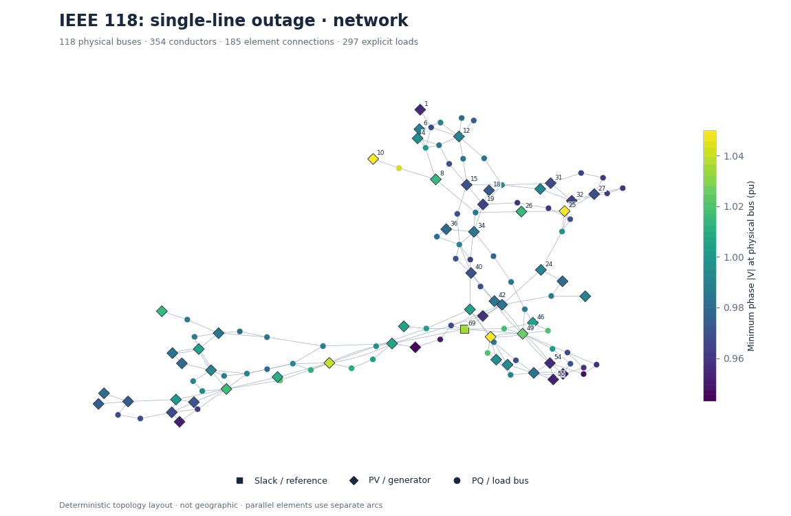
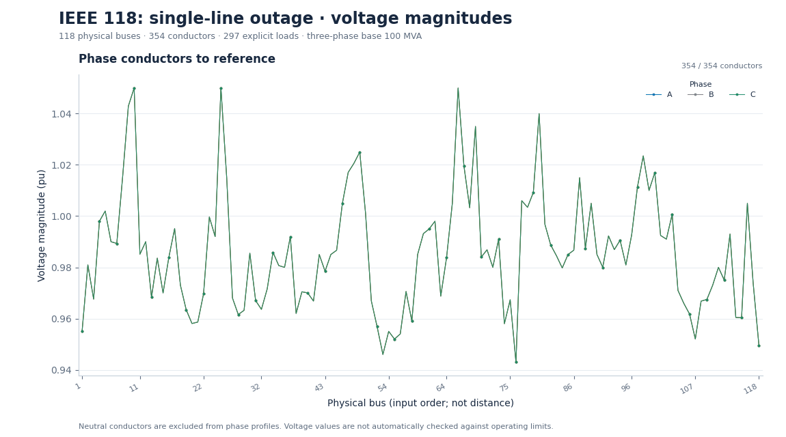
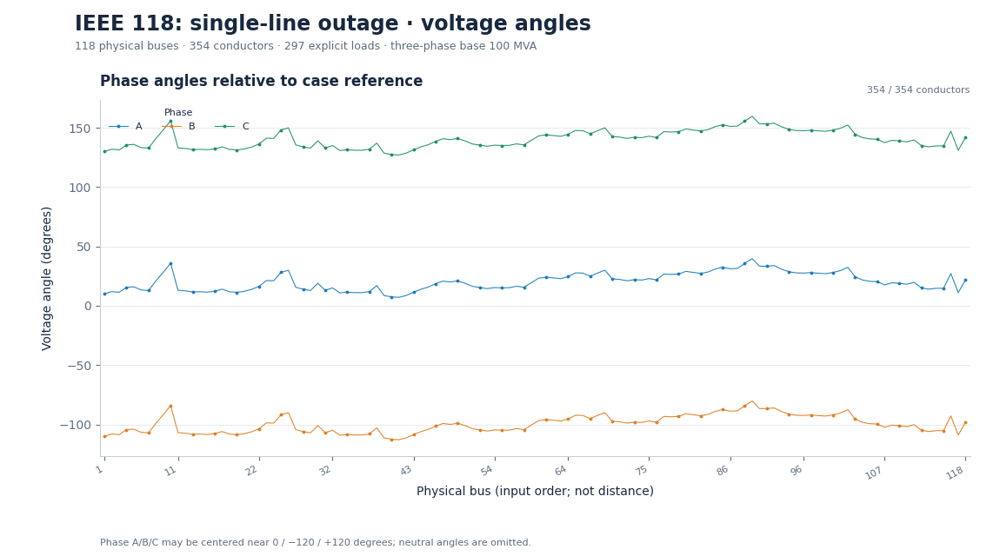
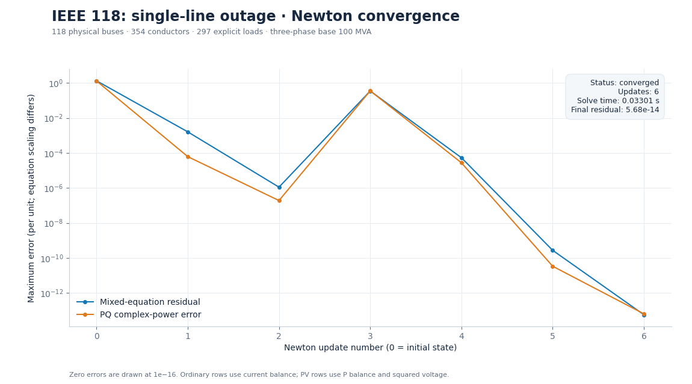
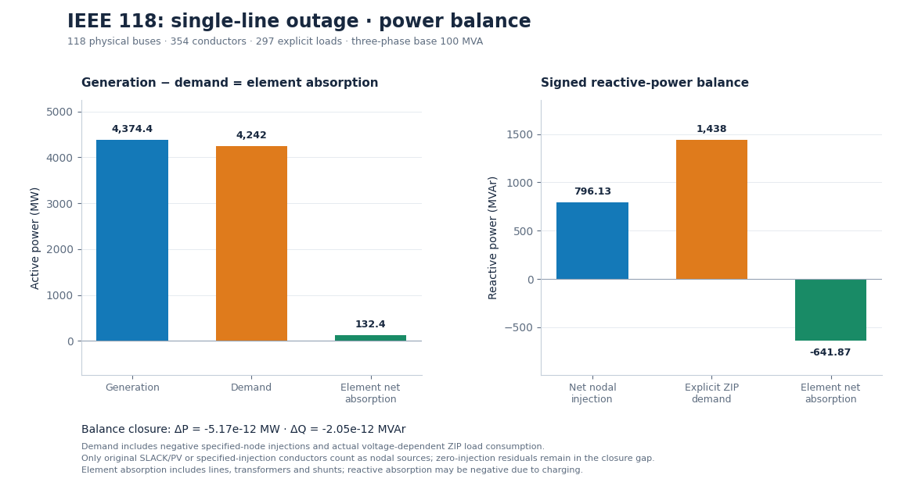

# IEEE 118: single-line outage

First non-islanding line in source row order is removed; remaining controls are unchanged.

**Status:** converged (converged).

## Parameters

```json
{
  "source_file": "case118.m",
  "branch_row_1based": 1,
  "from_bus": 1,
  "to_bus": 2
}
```

## Outputs

- [Numerical summary](study.json), [CSV summary](summary-00000.csv), [full ASCII network](network.txt).
- [Reloadable inputs](inputs/), [conductor results](nodes-00000.csv), [load results](loads-00000.csv), [element terminals](terminals-00000.csv), [iteration history](convergence-00000.csv).
- [Independent polar voltage comparison](reference-voltage.csv), [source voltage-bound checks](voltage-checks.csv), [generator checks](generator-checks.csv), [branch checks](branch-checks.csv).

## Figures

### Network diagram



[Zoomable SVG](figures/network.svg)

### Phase and neutral voltage



[Zoomable SVG](figures/voltage.svg)

### Voltage angles



[Zoomable SVG](figures/angles.svg)

### Convergence



[Zoomable SVG](figures/convergence.svg)

### Power balance



[Zoomable SVG](figures/power.svg)

[Collection index](../README.md) · [Acknowledgements and disclaimer](../../../ACKNOWLEDGEMENTS.md)
