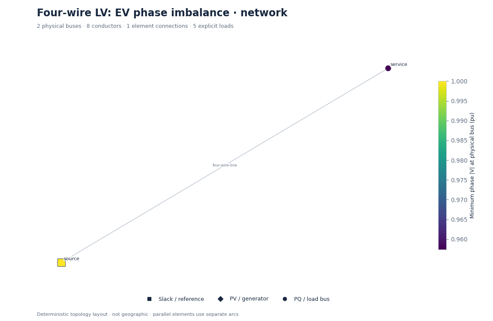
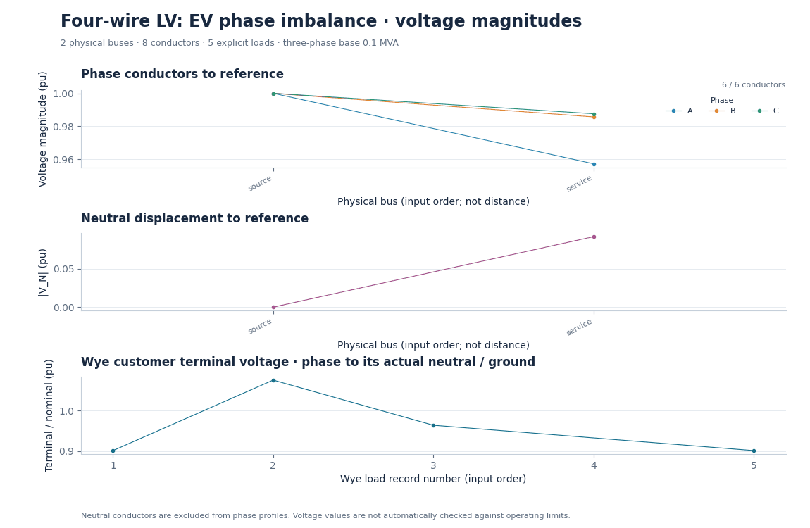
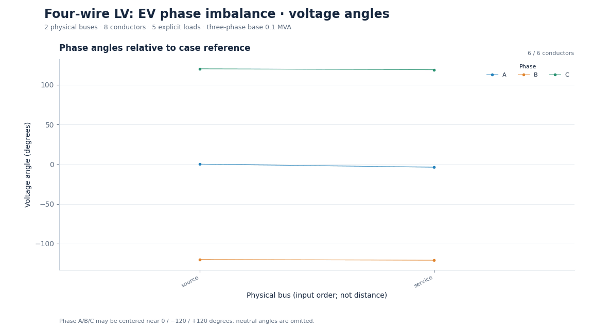
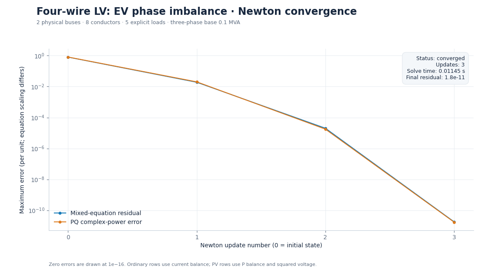
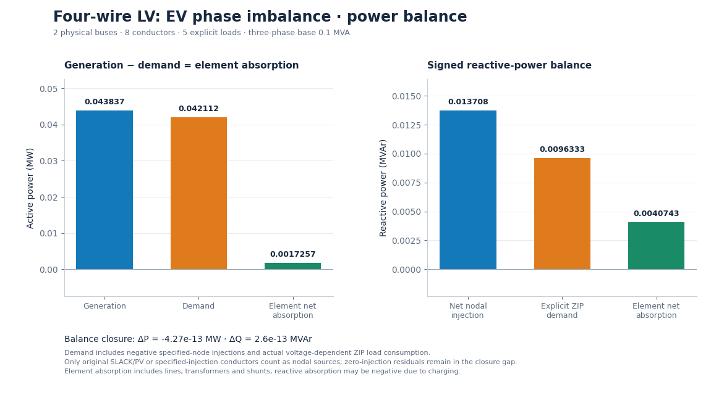

# Four-wire LV: EV phase imbalance

Two illustrative 7.5 kW chargers add 15 kW and 1.5 kvar to phase A.

**Status:** converged (converged).

## Parameters

```json
{
  "added_phase": "A",
  "added_kw": 15,
  "added_kvar": 1.5,
  "load_model": "constant power"
}
```

## Outputs

- [Numerical summary](study.json), [CSV summary](summary-00000.csv), [full ASCII network](network.txt).
- [Reloadable inputs](inputs/), [conductor results](nodes-00000.csv), [load results](loads-00000.csv), [element terminals](terminals-00000.csv), [iteration history](convergence-00000.csv).

## Figures

### Network diagram



[Zoomable SVG](figures/network.svg)

### Phase and neutral voltage



[Zoomable SVG](figures/voltage.svg)

### Voltage angles



[Zoomable SVG](figures/angles.svg)

### Convergence



[Zoomable SVG](figures/convergence.svg)

### Power balance



[Zoomable SVG](figures/power.svg)

[Collection index](../README.md) · [Acknowledgements and disclaimer](../../../ACKNOWLEDGEMENTS.md)
