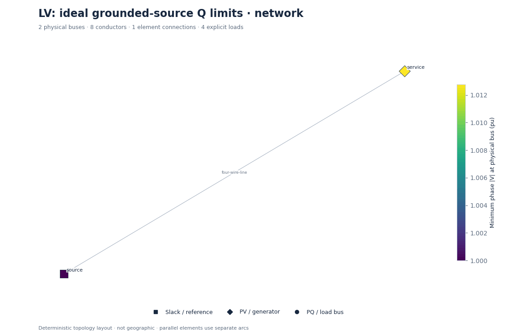
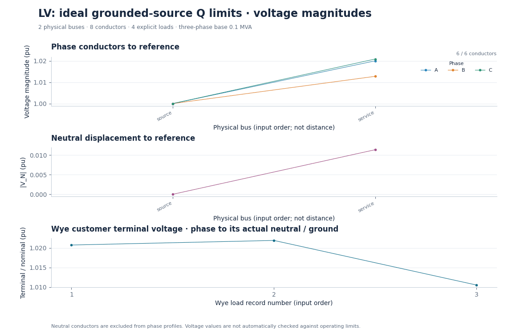
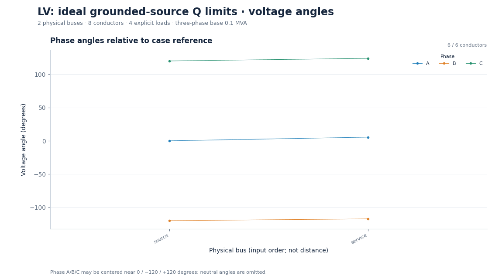
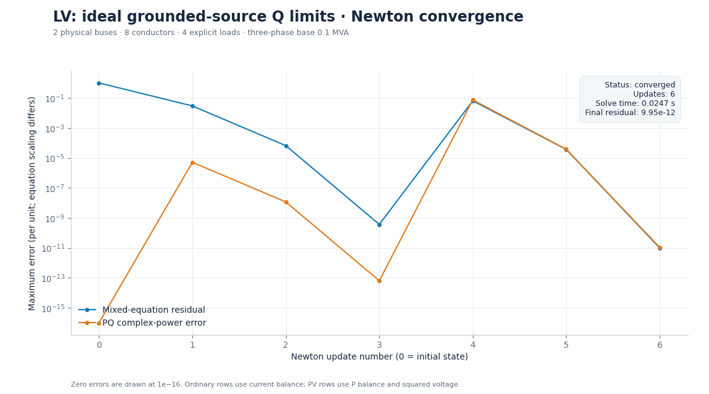
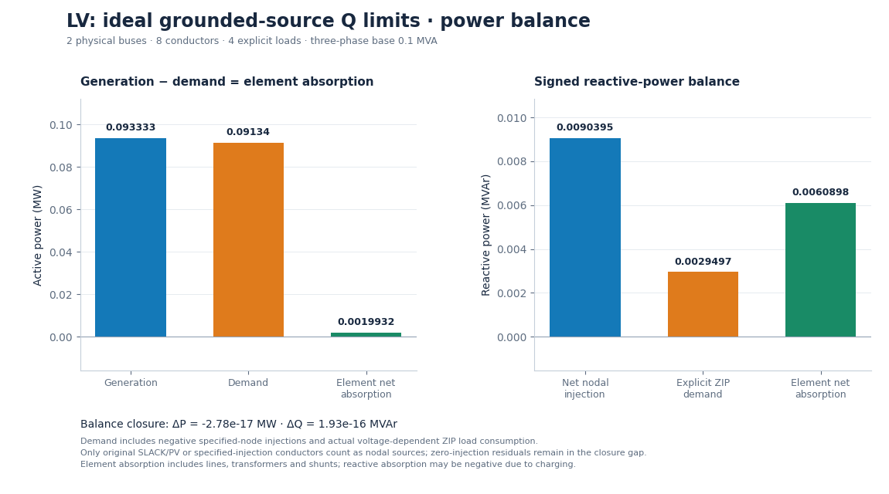

# LV: ideal grounded-source Q limits

Ideal ground-referenced sources target 1.02 pu with +/-1 kvar capability; source current returns to the ground reference.

**Status:** converged (converged).

## Parameters

```json
{
  "magnitude_setpoint_pu": 1.02,
  "per_phase_q_limit_kvar": 1,
  "controller": "ideal phase-to-ground PV control with Q-bound conversion"
}
```

## Outputs

- [Numerical summary](study.json), [CSV summary](summary-00000.csv), [full ASCII network](network.txt).
- [Reloadable inputs](inputs/), [conductor results](nodes-00000.csv), [load results](loads-00000.csv), [element terminals](terminals-00000.csv), [iteration history](convergence-00000.csv).

## Figures

### Network diagram



[Zoomable SVG](figures/network.svg)

### Phase and neutral voltage



[Zoomable SVG](figures/voltage.svg)

### Voltage angles



[Zoomable SVG](figures/angles.svg)

### Convergence



[Zoomable SVG](figures/convergence.svg)

### Power balance



[Zoomable SVG](figures/power.svg)

[Collection index](../README.md) · [Acknowledgements and disclaimer](../../../ACKNOWLEDGEMENTS.md)
