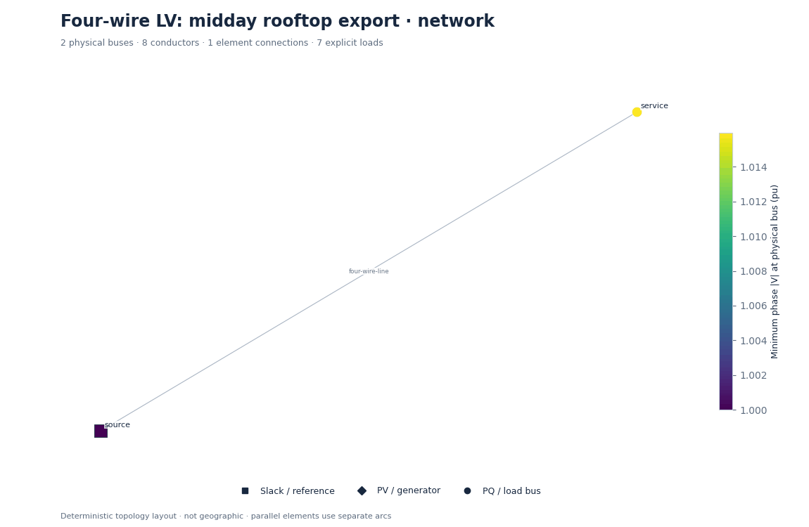
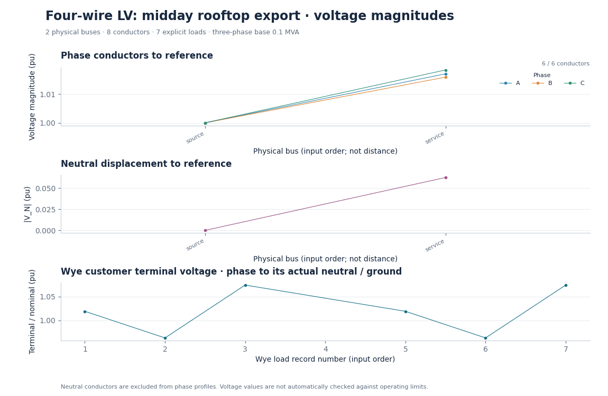
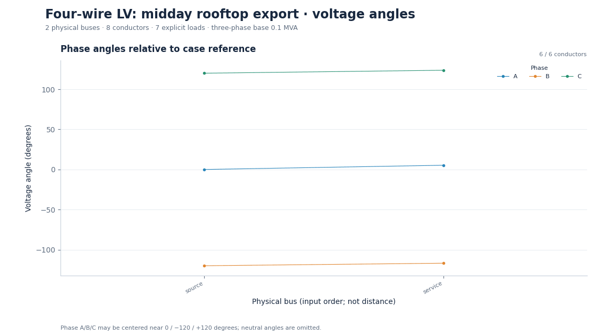
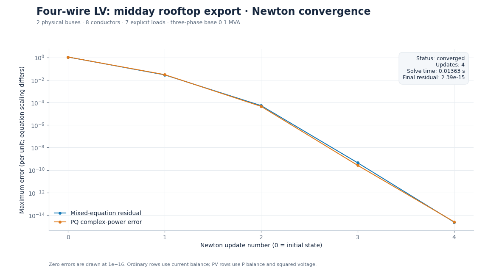
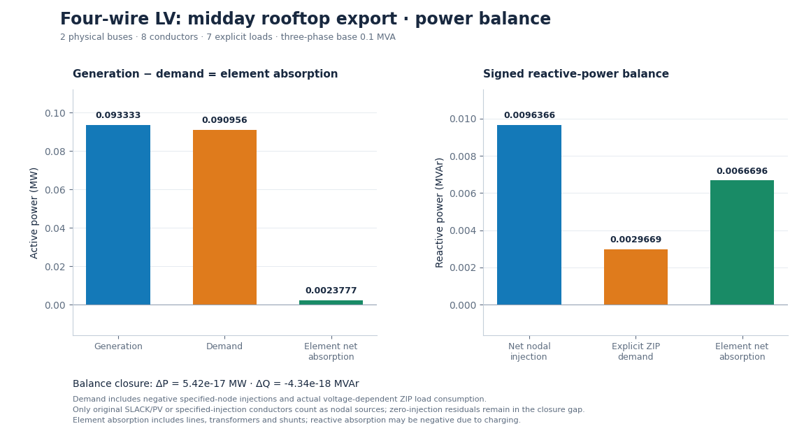

# Four-wire LV: midday rooftop export

Customer demand falls to 35% and unequal fixed-P rooftop generation exports through the feeder.

**Status:** converged (converged).

## Parameters

```json
{
  "demand_fraction": 0.35,
  "phase_generation_kw": {
    "A": 40,
    "B": 23.333333333333332,
    "C": 30
  },
  "generator_q_pu": 0
}
```

## Outputs

- [Numerical summary](study.json), [CSV summary](summary-00000.csv), [full ASCII network](network.txt).
- [Reloadable inputs](inputs/), [conductor results](nodes-00000.csv), [load results](loads-00000.csv), [element terminals](terminals-00000.csv), [iteration history](convergence-00000.csv).

## Figures

### Network diagram



[Zoomable SVG](figures/network.svg)

### Phase and neutral voltage



[Zoomable SVG](figures/voltage.svg)

### Voltage angles



[Zoomable SVG](figures/angles.svg)

### Convergence



[Zoomable SVG](figures/convergence.svg)

### Power balance



[Zoomable SVG](figures/power.svg)

[Collection index](../README.md) · [Acknowledgements and disclaimer](../../../ACKNOWLEDGEMENTS.md)
