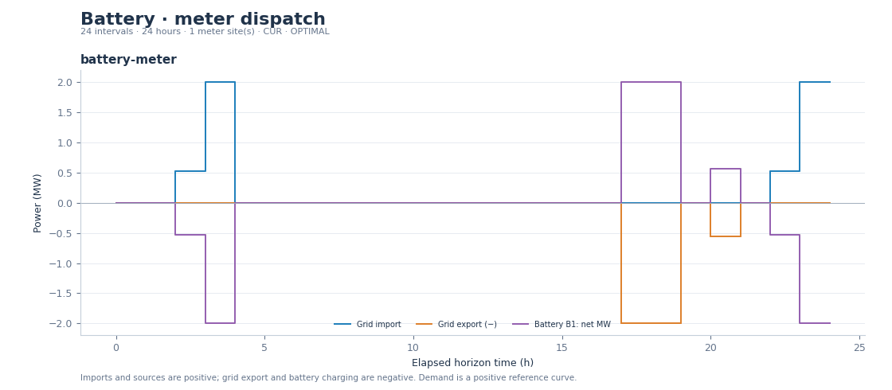
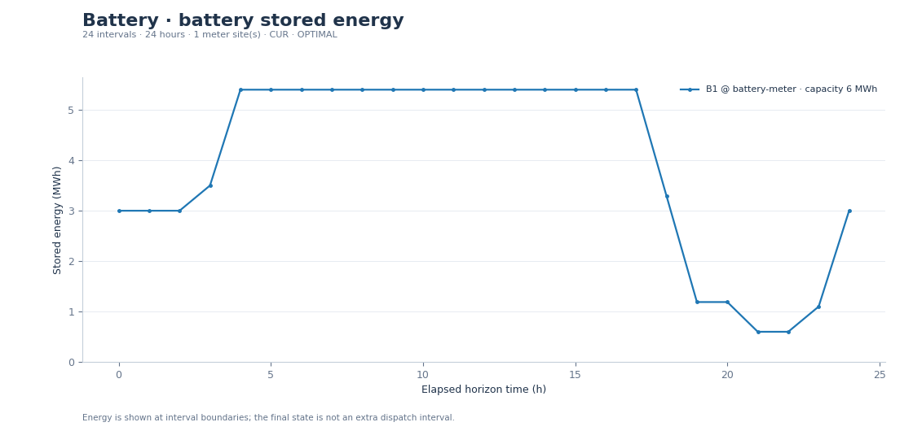
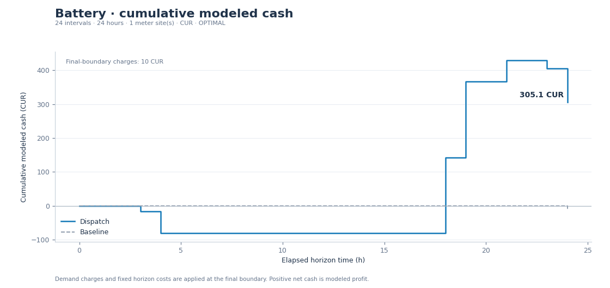

# Synthetic economic dispatch examples

All prices and forecasts are synthetic CUR inputs over one 24-hour horizon.

| Role | Net modeled value (CUR) | Benefit from storage (CUR) |
|---|---:|---:|
| [battery](battery/README.md) | 305.0993 | 315.0993 |
| [generator](generator/README.md) | 790.9600 | 0.0000 |
| [discom](discom/README.md) | 5600.6767 | 720.9343 |
| [aggregator](aggregator/README.md) | 2421.5619 | 587.3883 |

Each role includes reloadable inputs, dispatch/cash-flow CSVs, JSON receipts, ASCII asset diagrams and PNG/SVG plots. All four schedules passed independent replay and solved to the configured MILP gap.

[Projected six-hour replan](replan/README.md) carries SOC and the remaining discharge budget. [Battery sizing](sizing/planning.json) compares four user-cost candidates; their numbered folders preserve the input/schedule receipts.

[AC replay](ac-replay/grid-check.json) checks a synthetic passive two-wire feeder at a 0.01 MW interchange tolerance. The [strict-tolerance replay](ac-replay/grid-check-strict.json) identifies the unforecast resistive losses with the same converged schedule.

Reproduce in a new directory: `python -m nrlarge.economics.study --out my-economic-studies`. See the [user guide](../../docs/economics.md) for checking receipts and operating with measured state. `manifest.json` records producer versions and SHA-256 hashes.
